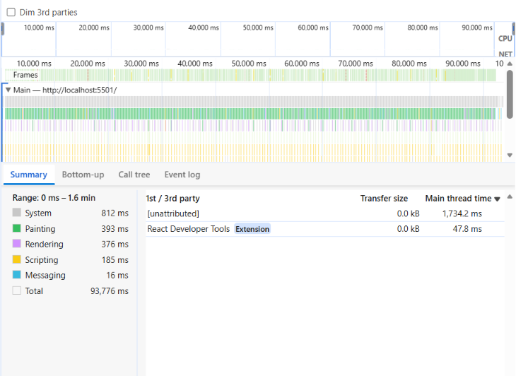
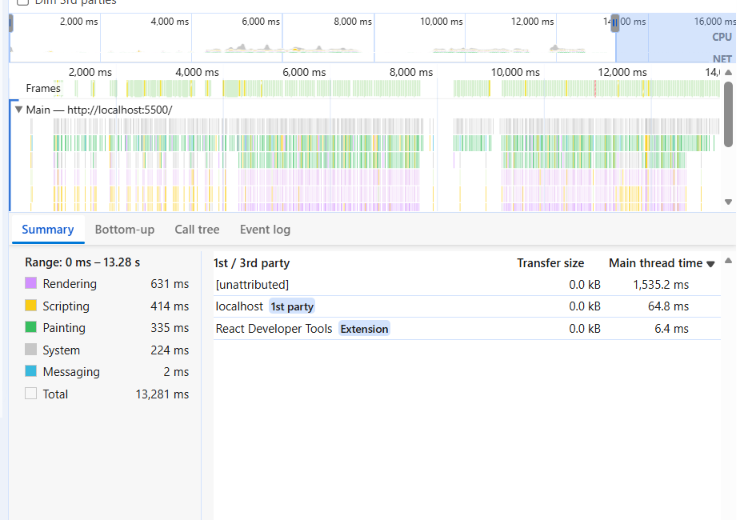
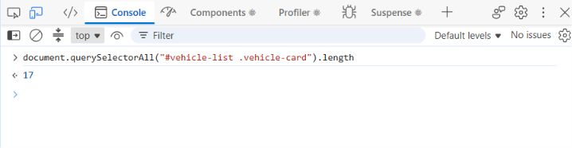

# Fleet Ops Console – Meridian Logistics

A responsive fleet operations dashboard built with HTML, CSS, and vanilla JavaScript. The project generates 400 sample vehicle records and uses list virtualisation to reduce the number of rendered DOM elements while preserving the complete scroll range.

## Task 2 – Virtualised List for 400 Rows

### What Changed

- Replaced the full 400-row DOM rendering approach with a virtualised rendering window.
- Renders visible vehicles along with an eight-row buffer above and below the viewport.
- Uses top and bottom spacer elements so the scrollbar represents the height of all 400 vehicles.
- Measures rendered row heights and updates cumulative offsets to support rows that become taller when the layout wraps.
- Uses `requestAnimationFrame` to batch scroll-driven rendering updates.
- Preserves the first visible vehicle and its within-row offset when the browser window is resized.
- Retains keyboard navigation with Up Arrow, Down Arrow, Home, and End.
- Uses no external UI libraries or virtualisation packages.

### How Virtualisation Works

The application calculates the first and last visible vehicle using the list's scroll position and viewport height. It then renders that range with an eight-row buffer.

Two spacer elements represent the height of all rows before and after the rendered window. This allows the complete dataset to remain available while only a small portion of the vehicle cards exists in the DOM.

Measured row heights are stored and converted into cumulative offsets. Binary search locates the row at a given scroll offset, while `requestAnimationFrame` avoids performing repeated DOM updates for every raw scroll event.

## Project Structure

```text
fleet-ops-console/
├── index.html
├── style.css
├── app.js
├── data/
│   └── vehicles.json
├── scripts/
│   └── generate-vehicles.js
├── screenshots/
│   ├── before-virtualisation.png
│   ├── after-virtualisation.png
│   └── after-dom-count.png
└── README.md
```

## Getting Started

### Prerequisites

Install Node.js and npm.

### 1. Generate Vehicle Data

```bash
node scripts/generate-vehicles.js
```

The script creates 400 vehicle records in `data/vehicles.json`.

### 2. Run the Website

Open the project folder in Visual Studio Code and start it using the Live Server extension or another local HTTP server.

Do not open `index.html` directly using a `file://` URL because the browser may block the JSON fetch.

### 3. Keyboard Navigation

| Key | Action |
|---|---|
| Down Arrow | Move to the next vehicle |
| Up Arrow | Move to the previous vehicle |
| Home | Move to the first vehicle |
| End | Move to the last vehicle |

## Performance Verification

Chrome DevTools Performance recordings were captured for both the original and virtualised versions using the same browser and scrolling approach.

The following observations were recorded:

| Check | Before Virtualisation | After Virtualisation |
|---|---|---|
| Vehicle records in dataset | 400 | 400 |
| Vehicle card elements in DOM | 400 | 17 |
| Scroll range | Full vehicle list | Full vehicle list |
| Scroll position after resizing | Original implementation | Preserved on the same visible vehicle |

The after-virtualisation DOM count was measured in Chrome DevTools Console using:

```javascript
document.querySelectorAll("#vehicle-list .vehicle-card").length
```

The measured result was **17 rendered vehicle cards**, rather than all 400 vehicle cards.

### Performance Evidence

#### Before Virtualisation

The following screenshot shows the Chrome DevTools Performance recording of the original implementation, before list virtualisation.



#### After Virtualisation

The following screenshot shows the Chrome DevTools Performance recording after implementing list virtualisation.



#### DOM Count Verification

The following screenshot shows the actual Chrome DevTools Console result confirming that only 17 vehicle cards were rendered in the DOM at the time of measurement.



## Task 2 Decision Log

| Decision | Reason |
|---|---|
| Vanilla JavaScript windowing | Keeps the project lightweight and avoids adding a dependency. |
| Eight-row render buffer | Reduces the chance of blank gaps while scrolling quickly. |
| Spacer elements | Preserve the total scroll height even though most vehicle rows are not mounted. |
| Measured row heights | Support responsive layouts where text may wrap and row heights can vary. |
| `requestAnimationFrame` | Aligns DOM updates with browser rendering frames. |
| Scroll anchor on resize | Keeps the same vehicle and relative position visible after resizing. |

## Data Validation

The original generator creates 400 unique vehicle records. Run it with `node scripts/generate-vehicles.js` if the dataset needs to be regenerated.

## Deployment

The project is hosted on GitHub Pages:

[https://maleeha1d2003.github.io/fleet-ops-console/](https://maleeha1d2003.github.io/fleet-ops-console/)

After committing and pushing changes to the `main` branch, GitHub Pages rebuilds the site from the repository root.

## Author

Frontend Development Internship Project

**Client:** Meridian Logistics

**Project:** Fleet Ops Console